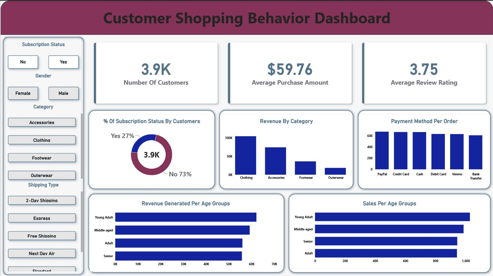

# 🛍️ Customer Shopping Behavior Analysis

📌 Overview

An end-to-end data analytics case study examining 3,900 retail transactions ($233,081 in gross revenue) to uncover customer spending patterns, demographic drivers, product performance, and subscription conversion opportunities. By integrating Python, PostgreSQL, and Power BI, this project translates raw transactional records into actionable commercial recommendations for revenue growth, customer retention, and margin protection.

Objective: Decode demographic purchasing drivers, evaluate subscription adoption among repeat buyers, and identify products overly dependent on promotional discounts.

Deliverables: Cleaned dataset, Python EDA & preprocessing notebook, 10 structured PostgreSQL analytical queries, an interactive Power BI executive dashboard, a formal written report, and an executive presentation deck built in Gamma.

📂 Repository Files & Structure

📄 Raw Dataset: customer_shopping_behavior.csv

🐍 Python EDA & ETL Notebook: Customer_Shopping_Behavior_Analysis.ipynb

🗄️ PostgreSQL Business Queries: Customer_Shopping_Data.sql

📊 Power BI Interactive Dashboard: Project_Power_BI.pbix

📁 Dataset

Source: customer_shopping_behavior.csv (3,900 rows × 18 columns)

Customer Demographics: Customer ID (1–3,900), Age (18–70, mean 44.1), Gender (68% Male / 32% Female), Location (50 US states), Subscription Status (27% Subscribed / 73% Unsubscribed).

Purchase Details: Item Purchased (25 unique items across Clothing, Accessories, Footwear, and Outerwear), Purchase Amount ($20–$100), Season, Size, and Color.

Behavioral Signals: Discount Applied, Promo Code Used, Previous Purchases (1–50, mean 25.4), Frequency of Purchases, Review Rating (2.5–5.0), and Shipping Type (6 delivery tiers).

🛠️ Tools & Technologies

Programming & Data Manipulation: Python (Pandas, NumPy, SQLAlchemy, psycopg2)

Database & Querying: PostgreSQL (Window Functions, CTEs, Aggregations, Case Statements)

Data Visualization & BI: Microsoft Power BI (KPI Cards, Dynamic Slicers, Cross-Filtering)

Reporting & Presentation: Formal Project Report (PDF/Doc), Gamma (Executive Case Study Deck)

Environment: Jupyter Notebook / VS Code

🚀 Project Steps (Workflow)

Data Profiling & Inspection (Customer_Shopping_Behavior_Analysis.ipynb): Audited 3,900 transactions using df.info() and .describe() to validate data types, check distributions, and identify 37 missing values in Review Rating.

Data Cleaning & Feature Engineering (Python):

Imputed 37 null Review Rating values using each product category's median rating to avoid category skew.

Standardized all 18 column names to snake_case for seamless PostgreSQL ingestion.

Engineered age_group cohorts (Young Adult, Middle-aged, Adult, Senior) and converted text purchase intervals into numeric purchase_frequency_days.

Verified 100% redundancy between discount_applied and promo_code_used (2,223 'No', 1,677 'Yes') and dropped the redundant column.

Database Integration & Querying (Customer_Shopping_Data.sql): Loaded the cleaned DataFrame into PostgreSQL via SQLAlchemy and executed 10 business-focused SQL queries covering revenue segmentation, shipping tier lift, discount dependency, customer loyalty tiers, and top-ranked SKUs using ROW_NUMBER() / DENSE_RANK().

Interactive Dashboard Development (Project_Power_BI.pbix): Connected Power BI to PostgreSQL to build an executive reporting layer featuring headline KPI cards (3.9K Customers, $59.76 AOV, 3.75 Avg Rating) and interactive slicers for Subscription Status, Gender, Product Category, and Shipping Type.

Reporting & Executive Presentation (Report & Gamma): Synthesized analytical findings and strategic recommendations into a formal report and a 9-slide executive presentation deck in Gamma.

📈 Dashboard

The interactive Power BI dashboard (Project_Power_BI.pbix) enables stakeholders to explore performance without writing SQL:

Headline KPIs: Total Customers (3.9K), Average Purchase Amount ($59.76), and Average Review Rating (3.75 / 5.0).

Visual Breakdowns: Subscription Split Donut (27% Yes vs. 73% No), Revenue & Sales Volume by Product Category, and Revenue & Sales Volume by Age Group.

Dynamic Slicers: Real-time filtering across Subscription Status, Gender, Product Category (Clothing, Accessories, Footwear, Outerwear), and Shipping Type (Standard, Express, 2-Day, Next Day Air, Free, Store Pickup).

(Tip: Upload an image of your Power BI dashboard to your repository and link it below)

💡 Key Results & Insights

Massive Subscription Opportunity: 72.4% of frequent repeat buyers (2,518 customers with >5 orders) remain unsubscribed, and current subscriber AOV ($59.49) shows no lift over non-subscribers ($59.87)—highlighting an immediate opportunity to introduce exclusive subscriber perks (free express shipping, early seasonal drops).

Discount Elasticity vs. Margin Risk: 839 shoppers used a discount code yet still spent above the $59.76 average (up to $97+), proving discounts can upsell basket sizes. However, Hats (50.0%), Sneakers (49.66%), and Coats (49.07%) rely on discounts for nearly half of all orders, requiring minimum-spend thresholds (e.g., 15% off $75+) to protect margins.

Demographic & Shipping Drivers: Male customers generate 67.7% of total revenue ($157,890 vs. $75,191 Female), while Young Adults lead age cohorts at $62,143 (26.7%). Express shipping users spend +$2.02 (+3.5%) more per order than Standard shipping users ($60.48 vs. $58.46).

High Retention, Low Acquisition: 79.9% of customers (3,116) fall into the Loyal segment while only 2.1% (83) are New buyers, signaling strong retention alongside a need for top-of-funnel referral campaigns.

Hero Products: Sandals rank #1 in Footwear volume (160 orders) and #2 in overall rating (3.84), while Gloves lead overall customer satisfaction (3.86)—making them prime candidates for featured campaigns and winter bundling.

⚙️ How to Run This Project

1. Clone the Repository

git clone https://github.com/Vivek-3130/Customer_Shopping_Behavior_Project.git
cd Customer_Shopping_Behavior_Project

2. Python Environment Setup & ETL

Install the required libraries:

pip install pandas numpy sqlalchemy psycopg2-binary jupyter

Open and run Customer_Shopping_Behavior_Analysis.ipynb using customer_shopping_behavior.csv to execute data profiling, median rating imputation, feature engineering, and PostgreSQL table loading.

3. Run PostgreSQL Business Queries

Ensure PostgreSQL is running locally or on your server.

Open pgAdmin or psql and connect to the database populated by the Python script.

Execute the analytical queries in Customer_Shopping_Data.sql to reproduce all 10 business metrics.

4. View the Power BI Dashboard

Download and open Project_Power_BI.pbix in Microsoft Power BI Desktop and refresh the data source connection if prompted.
